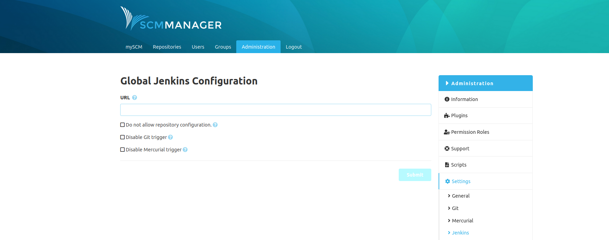
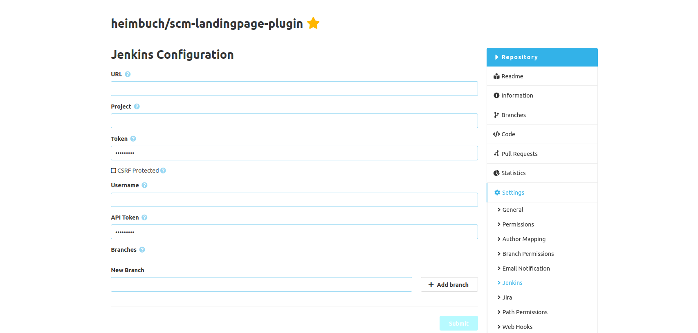

There are two quite different configurations for the scm-jenkins-plugin.

### Global configuration
In the global configuration, you can set the Jenkins instance URL and configure the VCS triggers.

The git trigger requires version 1.1.14 or above of the Jenkins Git plugin.
The mercurial trigger requires version 1.38 or above of the Jenkins Mercurial plugin.

The event trigger requires the installation of the [Jenkins SCM-Manager plugin](https://plugins.jenkins.io/scm-manager/) in Jenkins.
This informs Jenkins about changes to branches, tags, or pull requests.

Depending on your Jenkins configuration, you may have to set a username and a valid API token for this user, too. 
This is only required for SVN commit trigger requests if CSRF protection is activated on the Jenkins CI server.

Additionally, for Git, a "notifyCommit access tokens" is needed. 
This can be created in the global security configuration in Jenkins.

Finally, it is possible to disable the repository-specific configuration or to disable event triggers for specific
repository types.

#### Repository-specific Configuration
With the repository-specific configuration, build jobs for single repositories can be controlled.
Just the Jenkins instance URL and some kind of credentials are required. 
For authentication, you may have to use an authentication token (for example for git the “notifyCommit access token”)
and/or a username with an API token. 

You can filter the build job triggers by branches, so only build jobs of selected branches will be triggered on a repository push.

If the Jenkins build job is parameterized, you may also send parameters with each request.
The parameters consist of name and value pairs. The name must match the parameter name in the Jenkins build job exactly (case-sensitive).
The values may be absolute or relative values. For example, absolute values are `Trillian` as a string parameter or `true` as a boolean parameter.
The relative values can be used through an expression language from the repository push context (repository, commits).
It could be used like `${repository.id}` for the repository id or `${commit.author.mail}` to get the mail address from the committer.

